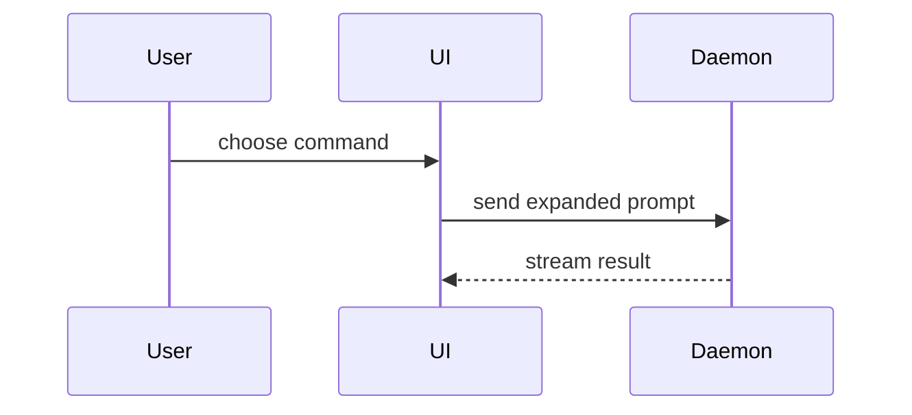

# Ship PR

Write a PR body that is fast to review and carries an explicit pre-launch verification gate when touching production boundaries or infrastructure.

## Process

1. Diff the branch against its base (`git diff <base>...HEAD` and `git log <base>..HEAD --oneline`).
2. Classify the touched seams:
   - **Pure application change**: write `Summary`, `Evidence` (**Before** and **After**), and `Merge Danger` (**Door** and **Blast Radius**).
   - **Infrastructure, config, migration, external integration, or production-boundary change**: call the Skill tool twice, for "infra-and-deploy" and "observability", to trace the full `App -> Container -> Helm/K8s -> Cloud IaC -> CI/CD` chain, run Tier 2 template/plan checks, and include the **Unverified Until Deploy** and **Rollback Plan** blocks in the template below.

Use this template for writing the PR body:

```markdown
## Summary

<diagram, diff-sketch, or tree>

## Evidence

### Verified Locally
- **Before:** <screenshot/output/failing test run>
  **After:** <screenshot/output/passing test run or rendered infra diff>

### Unverified Until Deploy
> Omit this subsection ONLY for pure application changes fully covered by local tests.
> Mandatory whenever touching Helm, K8s, AWS/Azure/GCP IaC, Docker, CI/CD, env/secrets, IAM/RBAC, or DB migrations.

- **Deploy-only seams:** <exact live bindings local tests cannot prove: IAM/Workload Identity, live Helm upgrade, secret presence, DNS/Ingress, migration lock>
- **Pre-apply check:** `<exact command: terraform plan / az deployment group what-if / helm diff upgrade / cdk diff>`
- **Post-deploy observability (first 15m):**
  - **Logs:** `<structured event name + requestId / entryPoint query>`
  - **Metrics & probes:** `<RED error rate & p95 latency, USE queue/pool saturation, pod readiness>`
  - **Canary gate:** Advance if error rate within 10% and p95 within 20% of baseline; Roll back if error rate >2x or p95 >+50%

## Merge Danger

**Door:** <one-way or two-way>

<optional: description>

**Blast Radius:** <one-word description>

<optional: potential ramifications of merge>

**Rollback Plan:** `<exact verified rollback command: helm rollback / workflow dispatch / feature flag off / migration down (omit for trivial pure-code changes)>`
```

## Sections

Skip all preambles and keep prose brief. Use the user's domain language from `GLOSSARY.md`.

### Summary

Pick the smallest view that makes the key point clear.

- Show logic or an algorithm as pseudocode:

```text
on(save)
  if content is unchanged
    return cached result
  write new content
  return fresh result
```

- Show runtime control flow as a call tree:

```text
submitForm
  createSession
    persistPrompt
    launchAgent
  navigateToSession
```

- Show UI structure as a component tree, including state and module boundaries that matter:

```text
<SessionPage> (apps/example/src/routes/session.tsx)
  useSessionEvents()
  <SessionToolbar>
    <RunSkillButton> (packages/ui)
```

- Show file responsibility or a broad refactor as a shallow file tree:

```text
src/
├── commands/       # parses user actions
├── sessions/       # owns session state
└── transport/      # sends API requests
```

- Show an App-to-Infrastructure chain when code crosses into config, containers, Helm/Kubernetes, or Cloud IaC:

```text
src/config.ts (reads INVOICE_QUEUE_URL)
  └── charts/app/values-prod.yaml + templates/deployment.yaml (env: INVOICE_QUEUE_URL)
        └── infra/main.bicep (ServiceBus queue + Managed Identity roleAssignment)
```

- Show component interaction, control flow, or data flow with Mermaid:



- Use `diff` when the point is what changes and the surrounding shape already exists. Match the diff shape to the topic.

For a component change:

```diff
 <SessionPage>
   useSessionEvents()
   <SessionToolbar>
+    <RunSkillButton />
   <SessionTimeline>
+    <SkillResultCard />
```

For a file-layout change:

```diff
 src/
 ├── commands/
+│   └── show-me.ts       # expands the slash command
 ├── sessions/
-└── transport.ts
+└── transport/
+    ├── client.ts
+    └── stream.ts
```

For a call-tree or call-stack change:

```diff
 submitForm
   createSession
     persistPrompt
+    expandSkillMention
     launchAgent
-  navigateToSession
+  navigateToSession
+    subscribeToEvents
```

For a state or control-flow change:

```diff
 on(save)
-  write content
+  if content is unchanged
+    return cached result
+  write new content
+  invalidate cache
```

- Show the whole block when most of it is new, when omitted context would hide ownership or order, or when the user needs a copyable target shape:

```ts
function expandSkill(command: string): string {
  const skillName = command.slice(1);
  return `use the ${skillName} skill`;
}
```

#### Guidance

Place each visual next to the short text it supports. Keep only the calls, files, props, states, and boundaries needed to answer the user's current question or the options to resolve the current discussion point.

You may use one of these, you may use several, it is unlikely you will use all of them. Use your judgement and don't overwhelm the user.

### Evidence

Concrete evidence that the change works. Show a before and after.

- **Screenshots** are S-tier when the environment is set up for it and the change is visual.
- **Execution-based evidence** is A-tier: test results, console output, or rendered infrastructure diffs (`helm template` diff, `terraform validate` / `plan`, `az bicep build` / `what-if`, `cdk diff`). Show the exact test that now fails and passes, using pseudocode.
- **Never claim local tests verified an infrastructure change.** Whenever Helm, Kubernetes, Terraform, Bicep, AWS/Azure/GCP resources, Dockerfiles, CI/CD pipelines, env/secret bindings, IAM/RBAC, or database migrations are touched, the **Unverified Until Deploy** block is mandatory.

### Merge Danger

Describe whether it's a one-way or two-way door. You can walk back through two-way doors, but not one-way doors. A PR that is cheap to roll back is lower risk. Changes that involve destructive actions or hard-to-reverse decisions (dropping or renaming a column or queue field in place, Terraform `-/+` or Bicep recreation of a stateful resource, changing immutable Kubernetes selectors or PVC templates, breaking a public API contract) are one-way doors.

The blast radius is the potential impact or scope of the changes introduced by this PR. Consider all possibilities. Examples are layout shift, breakages for consumers, mobile responsiveness, pod rollout restarts, queue backlog, or cloud resource replacement.
